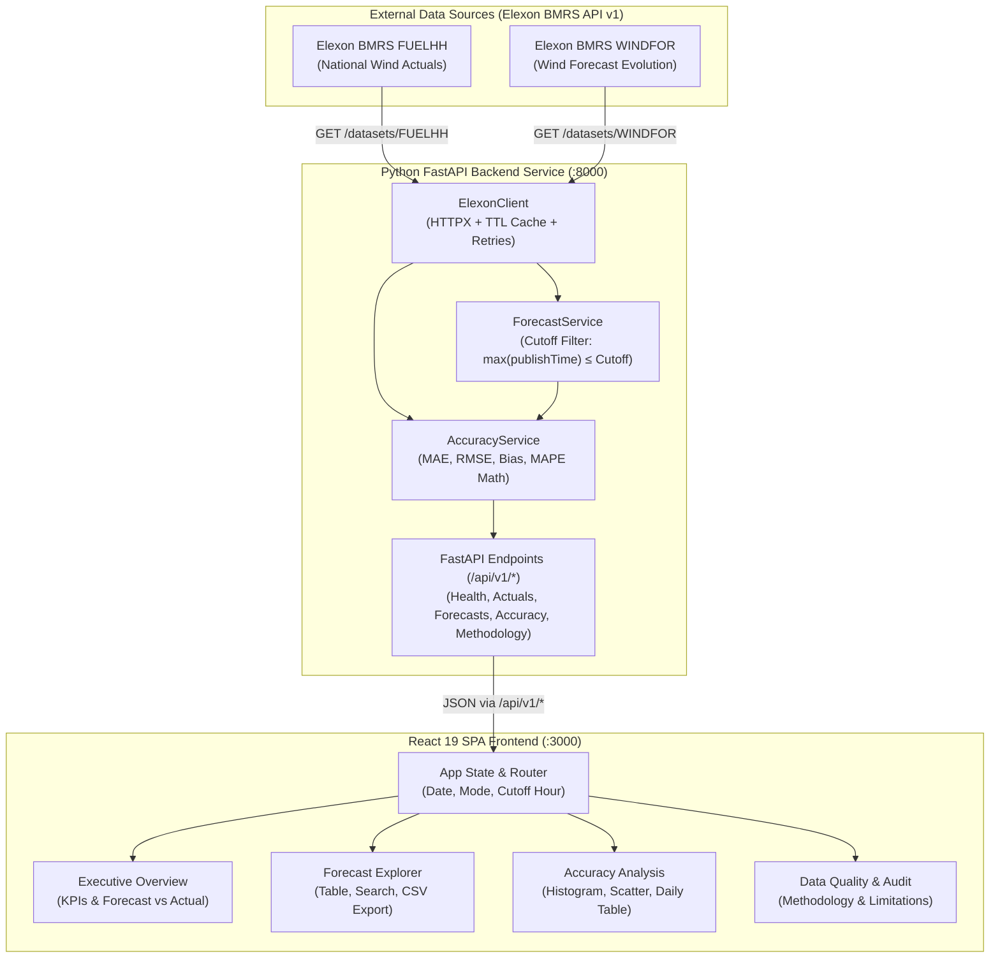

# WindWise — Renewable Forecast Intelligence
### Wind Forecast Accuracy & Day-Ahead Procurement Support for UK Electricity Wholesale Trading

[](https://fastapi.tiangolo.com)
[](https://python.org)
[](https://react.dev)
[](https://vitejs.dev)
[](https://tailwindcss.com)
[](https://pytest.org)

---

## 1. Product Overview & Problem Statement

In the Great Britain (GB) electricity wholesale market (BETTA), electricity suppliers and trading desks must commit their physical purchase contracts in the **Day-Ahead wholesale power auction** (operated by EPEX SPOT and Nord Pool) by **11:00 UTC on day D-1**. 

Because wind generation is weather-dependent and non-dispatchable, procurement analysts face two critical operational questions before gate closure:
1. **What wind generation forecast was actually available when the day-ahead purchasing decision had to be executed?**
2. **How accurate was that decision-time forecast compared with the actual wind generation subsequently delivered on the GB transmission system?**

### The Core Industry Pitfall: Lookahead Bias
Numerical weather prediction (NWP) models issue continuous revisions throughout day D-1 and delivery day D. If an analytics tool evaluates an analyst's day-ahead position against a forecast published at 20:00 UTC on D-1 or 06:00 UTC on day D, it introduces **lookahead bias**—judging the analyst using weather information that physically did not exist when their auction bid had to be placed.

**WindWise** solves this by strictly filtering Elexon BMRS historical forecast publication timestamps against configurable market gate closures (default **11:00 UTC on day D-1**). It provides energy traders with a quantitative, audit-grade evaluation of forecast accuracy, volumetric procurement risk, and systematic bias.

> **Scope Boundary Note:** WindWise is strictly scoped to national-level UK wind generation actuals and wind generation forecasts in **January 2026**. Electricity demand, thermal generation, interconnector flows, wholesale market clearing prices, and Balancing Mechanism cash-out prices are outside this scope.

---

## 2. Screenshots & Interface Preview

*(To capture real screenshots for demonstration, start the application and take high-resolution captures of the four core views)*

1. **Executive Overview Dashboard**: High-level KPIs (MAE, RMSE, Mean Bias, MAPE, Coverage), the primary interactive Forecast vs. Actual half-hourly chart with signed error ribbon, and wholesale peak delivery window analytics.
   > Place screenshot at: `docs/screenshots/01_executive_overview.png`

2. **Forecast Explorer**: Half-hourly settlement table (SPs 1–48) with sorting, text search, over/underforecast directional filters, lead time calculation, and one-click CSV export.
   > Place screenshot at: `docs/screenshots/02_forecast_explorer.png`

3. **Accuracy Analysis**: Quantitative evaluation with error distribution histograms, forecast vs. actual scatter plot with 1:1 reference line, signed error time series, and daily January 2026 accuracy benchmarks.
   > Place screenshot at: `docs/screenshots/03_accuracy_analysis.png`

4. **Data Quality & Audit Trail**: Upstream Elexon connection status, gate closure explanation, mathematical formulations, data cleansing steps, and explicit domain limitations.
   > Place screenshot at: `docs/screenshots/04_data_quality_audit.png`

---

## 3. Key Features

- **Decision-Time Forecast Selection**: Evaluates only the latest forecast published **on or before the 11:00 UTC D-1 auction cutoff**, excluding all post-cutoff revisions.
- **Latest Available Comparison Mode**: Toggle to compare the decision-time baseline against the latest forecast published prior to real-time delivery to evaluate forecast evolution.
- **Configurable Cutoff Gate Closures**: Switch between standard UK Auction Gate Closure (11:00 UTC D-1), Midday Cutoff (12:00 UTC D-1), End-of-Day Cutoff (17:00 UTC D-1), and Early Morning NWP (08:00 UTC D-1).
- **Audit-Grade Metric Engine**: Full analytical implementations of MAE, RMSE, Mean Bias Error (signed), and MAPE with zero-actual protection.
- **Full Month Multi-Day Benchmarking**: Aggregates daily performance across all 31 days in January 2026.
- **Half-Hourly Granularity**: Aligns all 48 settlement periods (00:00 to 23:30 UTC) with ISO 8601 UTC timestamps.
- **Cleaned Data Export**: Export the filtered half-hourly dataset to CSV for trading desk models.
- **Zero-Pill Enterprise UI**: Modern, accessible White and Green design aesthetic engineered for utility trading rooms.

---

## 4. Technology Stack

### Frontend
- **React 19** with **Vite 8**: Ultra-fast single-page application framework.
- **TypeScript**: Strict type definitions matching backend Pydantic schemas.
- **Tailwind CSS v4**: Clean White & Forest Green theme (`#064E3B`, `#059669`, `#F8FAFC`).
- **Recharts**: Responsive Composed, Scatter, Bar, and Line charts.
- **Lucide React**: Clean, accessible iconography.

### Backend
- **Python 3.10 / 3.11**: Modern Python backend runtime.
- **FastAPI**: Asynchronous, high-performance web API framework with automatic OpenAPI documentation.
- **Uvicorn**: Lightning-fast ASGI web server.
- **HTTPX**: Async HTTP client with connection pooling, timeouts, and bounded exponential backoff retries.
- **NumPy & Pandas**: Statistical operations, array mathematics, and percentile calculations.
- **Pydantic v2**: Strict schema validation and serialization.
- **Pytest**: Comprehensive test suite covering accuracy math, edge cases, cutoff filtering, and API contracts.

### Infrastructure & Deployment
- **Docker & Docker Compose**: Multi-stage container definitions for frontend (Nginx) and backend (FastAPI).
- **Reverse Proxy**: Built-in Vite and Nginx proxies routing `/api/*` requests to the Python backend.

---

## 5. Architecture Overview & Data Flow



---

## 6. Project Directory Structure

```
.
├── backend/
│   ├── app/
│   │   ├── api/
│   │   │   └── v1/
│   │   │       └── endpoints.py         # Route handlers for health, actuals, forecasts, accuracy
│   │   ├── clients/
│   │   │   └── elexon_client.py         # Dedicated Elexon BMRS API client with TTL caching
│   │   ├── core/
│   │   │   └── config.py                # App configuration, URLs, gate closures, CORS
│   │   ├── schemas/
│   │   │   └── models.py                # Pydantic v2 data models and API response schemas
│   │   ├── services/
│   │   │   ├── accuracy_service.py      # Statistical evaluation (MAE, RMSE, Bias, MAPE)
│   │   │   └── forecast_service.py      # Day-ahead decision cutoff & revision filtering
│   │   └── main.py                      # FastAPI application entry point
│   ├── tests/
│   │   ├── test_accuracy.py             # Math verification, zero-actuals, missing data
│   │   ├── test_api.py                  # API contracts, health check, date validation
│   │   └── test_forecast_selection.py   # Strict publication cutoff test cases
│   ├── .env.example
│   ├── Dockerfile                       # Python 3.11-slim container with health check
│   └── requirements.txt
├── src/
│   ├── components/
│   │   ├── Header.tsx                   # Top bar with date picker, cutoff selector, mode toggle
│   │   ├── KpiCard.tsx                  # Large numeric metric card with tooltips
│   │   └── Sidebar.tsx                  # Navigation sidebar with brand identity
│   ├── pages/
│   │   ├── AccuracyAnalysis.tsx         # Histograms, scatter plots, intraday error line
│   │   ├── DataQualityMethodology.tsx   # Complete audit page, formulas, market rationale
│   │   ├── ExecutiveOverview.tsx        # Executive dashboard, primary Recharts comparison
│   │   └── ForecastExplorer.tsx         # Half-hourly settlement table with CSV export
│   ├── services/
│   │   └── api.ts                       # Fetch client connecting to FastAPI backend
│   ├── types/
│   │   └── index.ts                     # TypeScript interfaces matching backend models
│   ├── App.tsx                          # App root orchestrating state & page routing
│   ├── index.css                        # Tailwind CSS v4 entry
│   └── main.tsx                         # React 19 bootstrap
├── docker-compose.yml                   # Multi-service stack (frontend + backend)
├── Dockerfile                           # Multi-stage frontend Dockerfile (Vite build + Nginx)
├── index.html                           # HTML shell with Google Fonts
├── metadata.json                        # Applet identity & permissions
├── package.json                         # Node dependencies & scripts
├── tsconfig.json                        # TypeScript configuration
├── vite.config.ts                       # Vite config with /api reverse proxy to port 8001
├── .env.example                         # Root environment variable documentation
└── README.md
```

---

## 7. Elexon API Sources & Fields Used

WindWise queries the official **Elexon BMRS API v1** directly (`https://data.elexon.co.uk/bmrs/api/v1`):

### Actual Wind Generation: `FUELHH`
- **Endpoint**: `/datasets/FUELHH`
- **Query Parameters**: `publishDateTimeFrom={start}&publishDateTimeTo={end}`
- **Field Filters**: `fuelType == 'WIND'`
- **Key Fields**:
  - `startTime`: ISO 8601 UTC timestamp of settlement period start.
  - `settlementDate`: Calendar date string (YYYY-MM-DD).
  - `settlementPeriod`: Settlement period index (1–48).
  - `generation`: Actual national metered wind generation in Megawatts (MW).

### Wind Generation Forecasts: `WINDFOR`
- **Endpoint**: `/datasets/WINDFOR`
- **Query Parameters**: `publishDateTimeFrom={start}&publishDateTimeTo={end}`
- **Key Fields**:
  - `publishTime`: Timestamp when the forecast run was published by the forecaster/TSO.
  - `startTime`: Target settlement period delivery timestamp when the generation is expected.
  - `generation`: Forecasted national wind generation in Megawatts (MW).

---

## 8. Day-Ahead Decision Timing Logic

A forecast in wholesale power markets is characterized by two distinct timestamps:
- **`publishTime`**: The exact moment the forecast run was generated and released.
- **`startTime`**: The delivery window in which electricity will flow onto the grid.

### The Selection Algorithm
For any target delivery day $D$ and settlement period starting at `startTime`:
1. Calculate the decision cutoff timestamp:
   $$\text{Cutoff} = (D - 1 \text{ day}) \text{ at } 11:00:00\text{ UTC}$$
2. Filter the universe of WINDFOR publications:
   $$\mathcal{F}_{\text{eligible}} = \{ f \in \text{WINDFOR} \mid f.\text{startTime} = \text{startTime} \;\land\; f.\text{publishTime} \le \text{Cutoff} \}$$
3. Select the most recent eligible forecast:
   $$f^* = \operatorname{argmax}_{f \in \mathcal{F}_{\text{eligible}}} (f.\text{publishTime})$$
4. Any forecast with $f.\text{publishTime} > \text{Cutoff}$ is **strictly excluded** from the day-ahead decision evaluation.

---

## 9. Accuracy Metric Formulas & Interpretation

| Metric | Mathematical Formula | Interpretation |
| :--- | :--- | :--- |
| **MAE** | $\frac{1}{N} \sum_{t=1}^N \|F_t - A_t\|$ | Mean Absolute Error in MW. Quantifies average magnitude of deviation. Lower is better. |
| **RMSE** | $\sqrt{\frac{1}{N} \sum_{t=1}^N (F_t - A_t)^2}$ | Root Mean Squared Error in MW. Penalizes large forecast swings that cause balancing stress. |
| **Mean Bias Error** | $\frac{1}{N} \sum_{t=1}^N (F_t - A_t)$ | Signed Error in MW. **Positive** means systematically overforecasting wind; **Negative** means systematically underforecasting wind. |
| **MAPE** | $\frac{1}{M} \sum_{A_t > 0} \frac{\|F_t - A_t\|}{A_t} \times 100\%$ | Mean Absolute Percentage Error. Calculated **strictly over non-zero actuals** ($A_t > 0$) to prevent division by zero during calm conditions. Returns `null` if no non-zero actuals exist. |
| **Coverage** | $\frac{N_{\text{matched}}}{N_{\text{total}}} \times 100\%$ | Percentage of the 48 target settlement periods with validated actuals and forecasts. |

---

## 10. Setup Prerequisites

- **Node.js**: v18.0 or newer (v20+ recommended).
- **Python**: v3.10 or newer (Python 3.11 recommended).
- **Docker & Docker Compose**: (Optional, for containerized run).
- **Git**: For cloning the repository.

---

## 11. Local Installation & Run Instructions

### Step 1: Clone Repository
```bash
git clone <your-repo-url>
cd windwise
```

### Step 2: Run Python Backend
```bash
cd backend
python3 -m venv venv
source venv/bin/activate  # On Windows: venv\Scripts\activate

pip install -r requirements.txt

# Start FastAPI server on port 8000
uvicorn backend.app.main:app --host 0.0.0.0 --port 8000 --reload
```
Verify the backend at: `http://localhost:8000/docs` or `http://localhost:8000/api/v1/health`

### Step 3: Run React Frontend
In a separate terminal:
```bash
# From workspace root
npm install
npm run dev
```
The React development server starts on `http://localhost:3000` and automatically proxies `/api/*` requests to the Python backend.

---

## 12. Docker Compose Instructions

To build and start the entire production-grade stack with one command:

```bash
docker compose up --build
```

- **Frontend**: Accessible at `http://localhost:3000`
- **Backend API**: Accessible at `http://localhost:8000`
- **Backend Health Check**: Automatically verifies `http://localhost:8000/api/v1/health`

To stop:
```bash
docker compose down
```

---

## 13. Environment Variables

Create `.env` in the root or set in your deployment dashboard:

```env
# Frontend Configuration
VITE_API_BASE_URL=""  # Leave empty for local Vite/Nginx proxy; set to external URL in production

# Backend Configuration
ELEXON_API_BASE_URL="https://data.elexon.co.uk/bmrs/api/v1"
DEFAULT_CUTOFF_HOUR=11
DEFAULT_CUTOFF_MINUTE=0
REQUEST_TIMEOUT_SECONDS=20.0
MAX_RETRIES=3
CACHE_TTL_SECONDS=3600
PORT=8000
```

---

## 14. Testing Instructions

WindWise includes a comprehensive Python automated test suite executed with `pytest`:

```bash
python3 -m pytest backend/tests -v
```

### Verified Test Results (15/15 Passed):
- `test_lead_time_hours_calculation`: Validates lead-time duration between publication and delivery.
- `test_standard_accuracy_metrics`: Verifies exact analytical values of MAE, RMSE, Bias, and MAPE.
- `test_zero_actual_handling_never_divides_by_zero`: Validates that periods with 0 MW actual generation do not cause division by zero.
- `test_missing_forecast_records`: Ensures periods missing forecasts are properly reported in coverage.
- `test_missing_actual_records`: Ensures periods missing actual generation are identified.
- `test_empty_dataset_handling`: Ensures empty inputs return null metrics rather than crashing or fabricating data.
- `test_root_endpoint`: Verifies service discovery metadata.
- `test_health_endpoint`: Verifies upstream Elexon BMRS connection health.
- `test_methodology_endpoint`: Verifies complete methodology dictionary.
- `test_invalid_date_validation_outside_january_2026`: Ensures dates outside January 2026 return HTTP 400.
- `test_date_range_ordering_validation`: Validates date range logic.
- `test_cutoff_timestamp_computation`: Verifies 11:00 UTC D-1 calculation.
- `test_forecast_selection_excludes_post_cutoff_revisions`: Verifies that revisions published after 11:00 UTC D-1 are excluded.
- `test_forecast_selection_with_earlier_cutoff`: Tests alternative auction cutoffs (e.g. 09:00 UTC).
- `test_latest_available_forecast_selection`: Tests pre-delivery forecast selection mode.

---

## 15. Deployment Instructions

### A. Deploy React Frontend to Vercel
1. Push repository to GitHub.
2. In the Vercel dashboard, click **Add New Project** and import the repository.
3. Framework Preset: **Vite**.
4. Root Directory: `./`
5. Build Command: `npm run build`
6. Output Directory: `dist`
7. In **Environment Variables**, set:
   - `VITE_API_BASE_URL`: The public HTTPS URL of your deployed Python backend (e.g., `https://api.windwise.energy`).
8. Deploy.

### B. Deploy Python FastAPI Backend
Compatible with any modern Python container host (Railway, Render, AWS ECS, Google Cloud Run):
1. **Google Cloud Run / Railway / Render**:
   - Use `backend/Dockerfile` or configure:
     - Build Command: `pip install -r backend/requirements.txt`
     - Start Command: `uvicorn backend.app.main:app --host 0.0.0.0 --port $PORT`
2. **Environment Variables**:
   - `ELEXON_API_BASE_URL`: `https://data.elexon.co.uk/bmrs/api/v1`
   - `DEFAULT_CUTOFF_HOUR`: `11`
3. **Health Check Path**: `/api/v1/health`

---

## 16. Known Limitations & Data Coverage

1. **National Aggregate Only**: Data represents GB-wide national wind generation. Regional transmission zones (e.g. Scotland B6 boundary) and offshore vs. onshore sub-metering are not broken down.
2. **Exclusion of Demand & Market Prices**: Electricity demand, wholesale market prices (£/MWh), and Balancing Mechanism System Buy/Sell Prices are not included. Volumetric error is presented in physical Megawatts (MW).
3. **January 2026 Scope**: The application's validation logic strictly restricts queries to `2026-01-01` through `2026-01-31`.

---

## 17. AI Tools Used During Development

- **Google AI Studio (Gemini 3.8 Flash)**: Used as the software engineering synthesis engine to design the architecture, generate test suites, structure the Elexon API client, and write the Tailwind/React components adhering to strict enterprise UI design rules.

---

## 18. Future Improvements

1. **Regional Constraint Breakdown**: Integrate BMU-level metering for Scottish transmission constraint management.
2. **Imbalance Cost Simulation**: Ingest Elexon SSP/SBP cash-out prices to calculate actual financial imbalance settlement charges incurred by forecast errors.
3. **Solar & Storage Co-Optimization**: Extend forecast intelligence to national solar PV and battery storage dispatch profiles.
